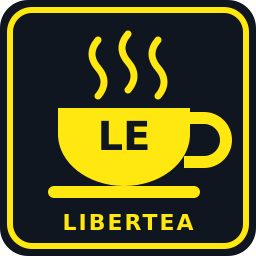

# Super LiberTEA - LE (Linux Edition)

One HD2 Arsenal mod that brings Live Lua Loader with LuaJIT and a full set of mods to Helldivers 2 on Linux. Import it, deploy it, play.

**Linux / Proton only. Helldivers 2 Steam build 26568081 only.** It will not work on native Windows.

## What's inside

| Item | Version |
|---|---|
| Live Lua Loader R38 (LuaJIT) | R38-26568081-luajit.1 |
| Mod Configuration Menu (DBF-MCM) | 0.1.74-luajit.8 |
| DBF Modular (the default DBF choice) | 0.1.0-dev.25 |
| Diver's Best Friend (ASS) (the other DBF choice) | R46, LuaJIT 26568081, without DBF-HUD's weapon readout |
| Vanilla Plus Megapack ("Bingus Pack") | v42, all 25 mods, LuaJIT 26568081 |
| Goose Bridge Combat | 0.1.17-experimental-26568081.1 (experimental) |
| War Journalist (Proton) with assets | 1.4.0 (bfbaca9), assets 1.2.0 |
| Goose Gadget Kit LE | 0.5.42, Spawner and First Person only |
| Nova Weapon FOV | 0.1.0 |
| DiverKit | Alpha 8.14.31, LuaJIT 26568081 r11 |
| HD2 Transmog Foundation | 0.2.4, LuaJIT 26568081 |
| Smarter Guard Dogs & Sentries | 5.2.0, LuaJIT 26568081 |

## Install

1. Download `Super-LiberTEA-LE-1.0.6-26568081.zip` from [Releases](../../releases).
2. Close the game. In HD2 Arsenal, disable any other Live Lua Loader, Bingus Shared Loader, Boot Mod Loader or Chef Shared Loader, and any separate copy of the mods above.
3. Import the zip. Every option is on; pick the sub-options you want (Transmog, Guard Dogs) and your DBF under "Live Lua Loader R38 (LuaJIT) + LLL mods": DBF Modular (default) or Diver's Best Friend R46 LE. Only one DBF runs.
4. Keep it **last** in the load order (with first-mod priority on, keep it first), then Purge / Deploy.
5. Start the game. The Mod Configuration Menu holds every mod's settings.

The first start writes LLL's files and the LLL mods into `%LOCALAPPDATA%\LLL\Helldivers2` inside the game's Proton prefix (`steamapps/compatdata/553850/pfx/drive_c/users/steamuser/AppData/Local/LLL/Helldivers2`). If you already installed your own build of one of those mods, it is left alone; a folder that only holds a development shim (a `main.lua` that loads the mod from a file elsewhere) is moved to `LLL/Helldivers2/Backups` and the mod installed. A file an earlier release wrote and this one no longer ships is removed, unless you changed it. Switching the DBF choice moves the other DBF to `LLL/Helldivers2/Backups` when this package installed it; one you installed yourself is left alone. Coming from 1.0.4, the first start switches LLL to the new LuaJIT runtime and updates the mods it installed. `README.txt` in the zip explains what is written, how to turn a single mod off and how to remove everything.

## Separate downloads

Each item is also on the release page on its own. Use either the full package or the separate downloads, not both. Every separate zip has a `SUPER-LIBERTEA-LE.txt` with its install steps and what it needs.

| Download (`Super-LiberTEA-LE-<version>-26568081-…`) | Install |
|---|---|
| `Live-Lua-Loader-R38-LuaJIT.zip` | Arsenal mod, last in the load order. Everything else needs it |
| `War-Journalist-Assets.zip`, `DiverKit.zip`, `Smarter-Guard-Dogs.zip`, `Vanilla-Plus-Megapack.zip`, `Transmog.zip`, `HudPlusPlus.zip` | Arsenal mods |
| `DBF-MCM.zip`, `DBF-Modular.zip`, `Divers-Best-Friend.zip`, `Bridge-Combat.zip`, `War-Journalist-Proton.zip`, `Gadget-Kit-LE.zip`, `Nova-Weapon-FOV.zip` | LLL mods: extract the folder into `%LOCALAPPDATA%\LLL\Helldivers2\Mods` in the game's Proton prefix (install one DBF only) |

Both DBFs use Mod Bindings Menu (in the Megapack); War Journalist uses its assets; Gadget Kit LE's and DBF Modular's pages are in DBF-MCM. HudPlusPlus (HD2 HUD Plus 0.2.9 rebuilt for build 26568081) is only a separate download; keep its row before Live Lua Loader.

## Source

Everything that goes into the zip is here, item by item. Each folder's `SOURCE.md` names the repository, branch and commit it came from.

| Folder | What |
|---|---|
| `sources/live-lua-loader` | LLL, HWG90/LLL `indev/lll-26568081` at 1cd9948 |
| `sources/luajit-runtime` | the LuaJIT boot runtime `hd2_luajit_runtime_d6c1aec33706b30e.dll` |
| `sources/dbf-mcm` | DBF-MCM |
| `sources/ass` | Diver's Best Friend (ASS) R46 LE |
| `sources/dbf-modular` | DBF Modular: the mod as shipped, its tests, tools and design notes |
| `sources/nova-weapon-fov` | Nova Weapon FOV: the mod, its tests and the notes of its port to 26568081 |
| `sources/vanilla-plus-megapack` | the Megapack's 25 mods as ported (Lua) |
| `sources/bridge-combat` | Bridge Combat and its weapon menu DLL builder |
| `sources/war-journalist-proton` | War Journalist 1.4.0, HWG90/DBF_PhotoMode Proton line at bfbaca9 |
| `sources/gadget-kit` | Goose Gadget Kit 0.5.42 with its tests and native helper sources (the LE changes are in `package/gadget-kit-le`) |
| `sources/diverkit`, `sources/transmog`, `sources/smarter-guard-dogs` | the ported mods' Lua, by option |
| `sources/hudplusplus` | HudPlusPlus Modular: its editable modules and build tools, the port builder and data, and its Lua |
| `package/` | how the zip is built: `build_package.py`, the boot install block `mods_install.lua`, its Wine test, and `lll-dropin/` (LLL's drop-in boot patch builder) |

`package/RECEIPT.json` records every input and output hash of the release build; `SHA256SUMS.txt` has the zip's hash.

## Changes

- **1.0.6**: Diver's Best Friend R46 LE is back, ported to Steam build 26568081: pick your DBF in Arsenal again, DBF Modular (the default) or Diver's Best Friend R46 LE; switching moves the other one to `Backups`. HudPlusPlus Modular for build 26568081, as a separate download.
- **1.0.5**: for Steam build 26568081 (the game update of 2026-11-11). Live Lua Loader R38-26568081-luajit.1 and every mod re-ported to the new build: DBF-MCM luajit.8, DBF Modular dev.25, Bridge Combat 26568081.1, War Journalist (Proton) 1.4.0, Nova Weapon FOV, DiverKit r11, Transmog, Smarter Guard Dogs & Sentries and the Megapack's 25 mods. Gadget Kit LE on 0.5.42: smoother True First Person (weapon offset pop guard, hitch-proof transitions, eased aim gait). DBF Modular is the one DBF: Diver's Best Friend R46 LE and HudPlusPlus are not in this release (no build for the new game version yet); a Diver's Best Friend that 1.0.4 installed moves to `Backups`.
- **1.0.4**: pick your DBF in Arsenal: DBF Modular (new, the default) or Diver's Best Friend R46 LE; switching moves the other one to `Backups`. War Journalist 1.4.0 (Proton). Gadget Kit LE on 0.5.38, with the rebuilt first-person camera, the loadout editor and the fifth stratagem by category. Nova Weapon FOV, new. DBF-MCM luajit.7 (faster menus). DiverKit r10 and Transmog: loadouts prepare weapon and stratagem selection before Apply. Diver's Best Friend R46: HUD+ stratagem handoff fixes. Know Your Constellation: the forecast panel keeps the player card and prompts clear. HudPlusPlus Modular.
- **1.0.3**: HudPlusPlus, HD2 HUD Plus 0.2.9 rebuilt for build 26251122, as a separate download. Gadget Kit LE's spawner: a support weapon that cannot be delivered ends its request instead of holding every later one, and a refused request shows its reason.
- **1.0.2**: War Journalist 1.3.4 with bone posing (pose a diver bone by bone in the Subject tab, keep up to 99 poses). Bridge Combat .12: Armory weapon swaps no longer crash, and combat starts in multiplayer sessions. Diver's Best Friend no longer starts DBF-HUD's weapon readout, which published R46 never had; the first start removes its files. Gadget Kit LE's First Person starts again: four of its modules were missing from its manifest since 1.0.0. LLL Compat Test is gone. Every item is also a separate download.
- **1.0.1**: the Megapack no longer names a folder on my machine (a helper DLL path its code never used), and a mod folder that only holds a development shim is moved to `Backups` and replaced with the real mod. On my machine, Diver's Best Friend failed to load from such a shim.
- **1.0.0**: first release.

## Credits

See [CREDITS.md](CREDITS.md). The Megapack, Smarter Guard Dogs & Sentries, DiverKit, Transmog and HD2 HUD Plus are other authors' mods, ported to LuaJIT and this game build; all credit for the mods themselves goes to them.

There is no repository-wide licence: each item keeps its own (see the licence files in each folder and `LICENSES/` in the zip).
